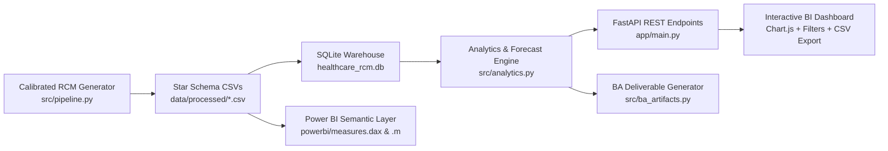
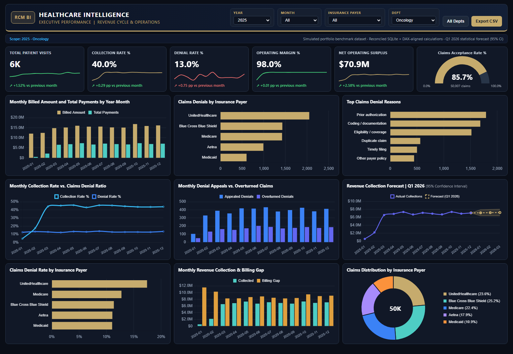
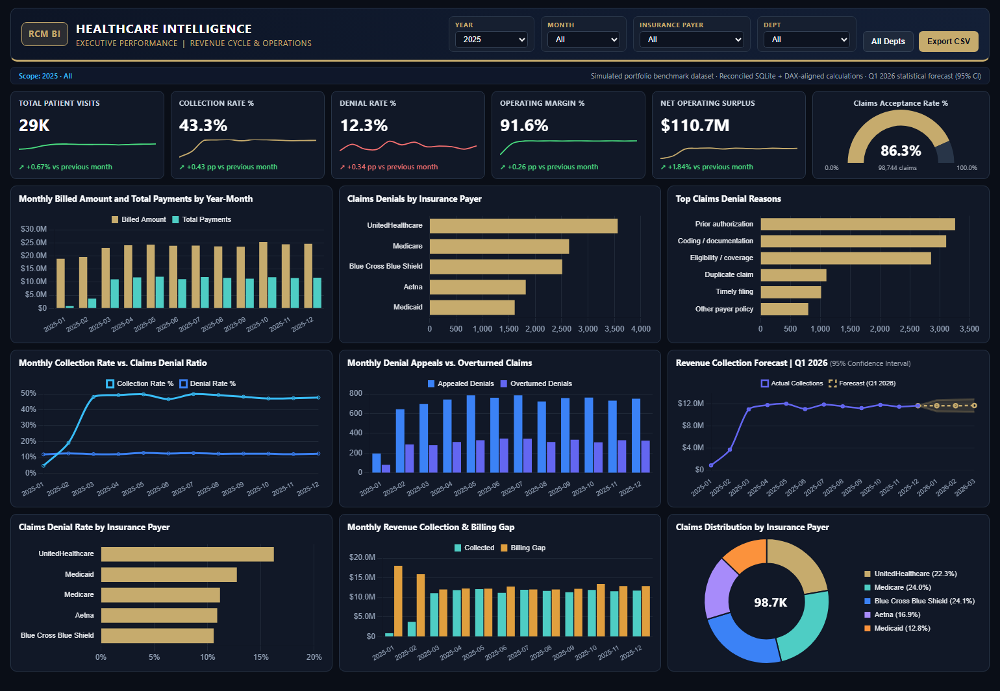

# Healthcare Revenue Cycle Intelligence

**Enterprise Business Analysis · Healthcare Analytics · Business Intelligence**


> An end-to-end Healthcare Revenue Cycle Management (RCM) Business Intelligence and Business Analysis platform consolidating patient visits, claims adjudication, insurance payer denial patterns, appeals recovery, and Q1 2026 statistical cash-collection forecasting into a governed star schema and interactive executive dashboard.

---

## 1. Executive Summary

Healthcare organizations rely on accurate visibility across patient encounters, claims submission, payer adjudication, denials management, and payment posting to safeguard financial sustainability. When operational data sits across disconnected spreadsheets and billing reports, revenue cycle leaders struggle to diagnose payer-specific leakage or quantify collections risk.

**Healthcare Revenue Cycle Intelligence** delivers an integrated analytical warehouse (`SQLite` + star-schema CSVs), an interactive dark-executive web BI dashboard (`FastAPI` + `Chart.js`), reusable `DAX` and `Power Query (M)` engineering assets, and a complete Business Analysis governance suite (`BRD`, `Stakeholder & RACI`, `AS-IS/TO-BE Process Maps`, `RTM`, `Agile User Stories`, `UAT Plan & Defect Log`, and `Executive Insights`).

- **Intended Users:** CFO / Finance Leadership, Revenue Cycle Managers, Billing & Claims Teams, Denial Management Teams, Clinical Department Managers, and BI/Business Analysts.
- **Data Disclosure:** Built on a deterministic, calibrated FY 2025 benchmark dataset (`29,000` visits / `98,744` claims across 5 clinical departments, including a `6,000`-visit / `50,007`-claim Oncology reference slice) because live hospital EHR extracts are not publicly shareable.

---

## 2. Business Problem Statement

Fragmented healthcare revenue cycle reporting impedes leadership ability to track reimbursement efficiency and denial exposure across payers and departments. Key operational blind spots observed in the analytical dataset include:

| Performance Indicator | Oncology Reference View | Organization-Wide (All 5 Depts) | Analytical Implication |
| :--- | :--- | :--- | :--- |
| **Patient Visits** | `6,000` | `29,000` | Encounter baseline across FY 2025 |
| **Total Claims Processed** | `50,007` | `98,744` | Multi-line procedural claims volume |
| **Collection Rate %** | `40.0%` | `43.26%` | Significant gap between gross charges and realized cash |
| **Claims Denial Rate %** | `12.99%` | `12.30%` | Above-benchmark denial leakage requiring root-cause triage |
| **Claims Acceptance Rate %** | `85.69%` | `86.34%` | Remaining `~1.3%` claims pending adjudication |
| **Highest Payer Denial Rate** | UnitedHealthcare (`17.41%`) | UnitedHealthcare (highest across payers) | Concentrated commercial payer friction |
| **Dominant Denial Drivers** | Prior authorization, Coding/documentation, Eligibility/coverage | Prior authorization, Coding/documentation, Eligibility/coverage | >75% of denials concentrated in preventable front/mid-cycle steps |

---

## 3. Project Objectives

| ID | Business Objective |
| :--- | :--- |
| `BO-01` | Establish centralized executive visibility into healthcare revenue cycle KPIs. |
| `BO-02` | Evaluate claims acceptance, denial rates, and payer-specific performance across 5 payers. |
| `BO-03` | Analyze monthly billed amounts, total payments, and billing gaps across FY 2025. |
| `BO-04` | Classify and rank top claims denial reasons to target root-cause remediation. |
| `BO-05` | Monitor monthly denial appeals vs. overturned claims recovery. |
| `BO-06` | Establish a governed KPI dictionary and interactive multi-dimensional filtering. |
| `BO-07` | Generate a Q1 2026 monthly revenue collection forecast with 95% confidence bounds. |

---

## 4. Proposed Solution

1. **Star Schema Data Warehouse (`sql/schema.sql`, `src/pipeline.py`):** Normalizes raw operational activity into `dim_date`, `dim_payer`, `dim_department`, `dim_denial_reason`, `fact_patient_visits`, `fact_claims`, and `fact_denials_appeals`.
2. **Reconciled Analytical & Forecasting Engine (`src/analytics.py`):** Computes exact SQL-backed KPIs, Month-over-Month (MoM) deltas, payer benchmarking, appeals subset metrics, and steady-state OLS regression forecasting for Q1 2026 (`Jan–Mar 2026`) with 95% t-distribution prediction intervals.
3. **Interactive Executive BI Dashboard (`app/`):** Provides instant filtering across `Year`, `Month`, `Insurance Payer`, and `Department` (with quick `All Depts` reset and CSV export), displaying 6 executive KPI cards with sparklines/gauge and 9 interactive charts.
4. **Power BI & Business Analysis Deliverable Suite (`powerbi/`, `docs/business-analysis/`):** Supplies full `.dax` measures, `.m` Power Query scripts, ERD documentation, Excel `RTM` & `UAT` workbooks, and a ReportLab executive insights PDF.

---

## 5. Methodology & Implementation Approach

This initiative applies a structured Business Analysis lifecycle:

`Discover → Analyze → Define → Design → Validate → Recommend`

- **AS-IS / TO-BE Re-engineering:** Transitions manual spreadsheet reconciliation across disconnected billing/denial extracts into an automated single-source-of-truth star schema with standardized KPI definitions.
- **Mathematical Reconciliation:** Enforces strict accounting invariants (`Accepted + Denied + Pending == Total Claims`, `Billed - Payments == Billing Gap`, `Overturned <= Appealed <= Denied`) across both Python/SQL and Power BI DAX semantics.
- **Scope Transparency:** Explicitly displays the active filter context (`Oncology` vs. `All Departments`) so department-filtered benchmarks are never misrepresented as enterprise totals.

---

## 6. Key Features & Capabilities

- **Executive KPI Strip & Gauge:** Total Patient Visits, Collection Rate %, Denial Rate %, Operating Margin %, Net Operating Surplus, and Claims Acceptance Rate % radial gauge with MoM deltas and 12-month sparklines.
- **Interactive Slicers & Validation:** Filter dynamically by `Year`, `Month`, `Insurance Payer`, and `Department`, with HTTP 400 validation against invalid query inputs.
- **Monthly Financial & Appeals Tracking:** Billed vs. Paid amounts, Billing Gap comparison, Collection Rate vs. Denial Ratio trends, and Appealed vs. Overturned claims.
- **Payer & Root-Cause Intelligence:** Claims share donut, payer denial counts, ranked payer denial rates, and top 6 denial reason categories.
- **Q1 2026 Collection Forecast:** 3-month statistical projection (`2026-01` through `2026-03`) with shaded 95% confidence corridors.
- **Data Export & Automation:** One-click filtered monthly CSV export (`/api/export/monthly-csv`) and automated `.xlsx`/`.pdf` BA artifact generation.

---

## 7. Technology Stack

| Layer | Technologies Used |
| :--- | :--- |
| **Backend & API** | Python 3.13, FastAPI, Uvicorn, Pydantic |
| **Data & Analytics** | SQLite (`sqlite3`), Pandas, NumPy, SciPy (`linregress`, `t` CI) |
| **Interactive Frontend** | HTML5, CSS3, Vanilla JavaScript, Chart.js 4.4.7 (vendored) |
| **BI Semantic Reference** | Power BI DAX (`measures.dax`), Power Query M (`power_query.m`) |
| **BA Artifacts & QA** | OpenPyXL (`.xlsx`), ReportLab (`.pdf`), Mermaid, Pytest, HTTPX |

---

## 8. Architecture & Workflow



---

## 9. Project Structure

```text
healthcare-revenue-cycle-intelligence/
├── app/
│   ├── main.py                      # FastAPI web server & REST/CSV endpoints
│   ├── static/
│   │   ├── css/dashboard.css        # Executive dark-navy/gold BI styling
│   │   ├── js/dashboard.js          # Interactive Chart.js visuals & slicer state
│   │   └── vendor/chart.umd.min.js  # Bundled Chart.js library
│   └── templates/index.html         # Main interactive dashboard shell
├── assets/screenshots/              # Genuine rendered dashboard captures
├── data/processed/                  # Normalized star schema CSV files
├── docs/business-analysis/          # 8 BA docs + rtm_workbook.xlsx + uat_test_log.xlsx + PDF
├── powerbi/
│   ├── data_model.md                # Star schema ERD & relationship matrix
│   ├── measures.dax                 # Complete DAX measure definitions
│   └── power_query.m                # Power Query M ingestion template
├── sql/
│   ├── schema.sql                   # Relational DDL with FK constraints & indexes
│   └── analytics_queries.sql        # Production SQL reporting queries
├── src/
│   ├── config.py                    # Domain metadata & path configuration
│   ├── pipeline.py                  # Deterministic ETL & SQLite loader
│   ├── analytics.py                 # Reconciled KPI queries & Q1 2026 forecast
│   └── ba_artifacts.py              # Programmatic Excel & PDF report builder
├── tests/test_project.py            # Automated functional, math & API tests
├── pytest.ini
├── requirements.txt
└── run.py                           # Unified CLI build & server launcher
```

---

## 10. Installation & Setup

```bash
git clone https://github.com/abrahamnewwine-web/healthcare-revenue-cycle-intelligence.git
cd healthcare-revenue-cycle-intelligence
python -m venv .venv
# Windows: .venv\Scripts\activate | macOS/Linux: source .venv/bin/activate
pip install -r requirements.txt
```

---

## 11. Usage Instructions

### Build Warehouse & BA Artifacts Only
```bash
python run.py --build-only
```

### Launch Full Interactive Dashboard
```bash
python run.py --port 8001
```
Open `http://127.0.0.1:8001/` in your browser. Interactive API documentation is also available at `http://127.0.0.1:8001/docs`.

### Run Automated Verification Suite
```bash
pytest -v
```

---

## 12. Screenshots & Visual Documentation

### Oncology Reference View (`Year = 2025`, `Department = Oncology`)


### Organization-Wide View (`Year = 2025`, `Department = All`)


---

## 13. Video Demonstration

Video Demonstration: Coming Soon.

---

## 14. Deliverables

- **Executable ETL & SQLite Star Schema:** [`src/pipeline.py`](src/pipeline.py), [`sql/schema.sql`](sql/schema.sql), [`sql/analytics_queries.sql`](sql/analytics_queries.sql)
- **Interactive BI Web Application:** [`app/main.py`](app/main.py), [`app/templates/index.html`](app/templates/index.html)
- **Power BI Developer Suite:** [`powerbi/data_model.md`](powerbi/data_model.md), [`powerbi/measures.dax`](powerbi/measures.dax), [`powerbi/power_query.m`](powerbi/power_query.m)
- **Business Analysis Portfolio Suite:**
  - [01 — Business Case & Problem Statement](docs/business-analysis/01-business-case.md)
  - [02 — Business Requirements Document (BRD)](docs/business-analysis/02-brd.md)
  - [03 — Stakeholder Analysis & RACI Matrix](docs/business-analysis/03-stakeholder-raci.md)
  - [04 — AS-IS / TO-BE Process Mapping & Gap Analysis](docs/business-analysis/04-process-mapping-gap-analysis.md)
  - [05 — Requirements Traceability Matrix](docs/business-analysis/05-requirements-traceability-matrix.md) & [`rtm_workbook.xlsx`](docs/business-analysis/rtm_workbook.xlsx)
  - [06 — Agile Epics, Features & User Stories](docs/business-analysis/06-agile-epics-user-stories.md)
  - [07 — UAT Test Plan & Defect Log](docs/business-analysis/07-uat-test-plan-and-defect-log.md) & [`uat_test_log.xlsx`](docs/business-analysis/uat_test_log.xlsx)
  - [08 — Executive Insights & Recommendations](docs/business-analysis/08-executive-insights-recommendations.md) & [`executive_insights_report.pdf`](docs/business-analysis/executive_insights_report.pdf)

---

## 15. Business Value & Impact

- **Observed Analytical Value:** Consolidates 7 relational tables and 15+ KPI definitions into a single governed platform, surfacing payer denial concentrations (`17.41%` UnitedHealthcare denial rate in Oncology) and front/mid-cycle denial root causes.
- **Expected Operational Benefits (Requires Live Deployment):** Accelerating prior-authorization checks, targeting coding audits, and enforcing appeal SLAs are expected to improve clean-claim acceptance rates and shorten cash-collection cycles once integrated with live EHR/clearinghouse workflows.

---

## 16. Testing & Validation

All 9 automated tests in [`tests/test_project.py`](tests/test_project.py) verify:
- Foreign-key warehouse integrity (`0` orphan claims or invalid denials)
- Mathematical reconciliation of Oncology and Organization-wide KPIs
- Claim status partition (`Accepted + Denied + Pending == Total Claims`)
- Monthly billing gap equality (`Billed - Payments == Billing Gap`)
- Appeals subset invariant (`Overturned <= Appealed <= Denied`)
- Q1 2026 forecast interval monotonicity (`lower_95 <= forecast <= upper_95`)
- FastAPI HTTP 200 / HTTP 400 validation and CSV export structure
- Excel & PDF BA artifact generation

---

## 17. Limitations & Future Enhancements

- **Benchmark Dataset:** Uses a calibrated synthetic dataset modeled on healthcare RCM dynamics rather than live patient PHI.
- **Forecasting Scope:** Q1 2026 projections rely on steady-state linear trend regression and do not incorporate external payer contract renegotiations.
- **Future Enhancements:** HL7/FHIR or EDI 835/837 ingestion connectors, automated payer appeal letter generation, and role-based authentication.

---

## 18. Author Information

**Abraham Adetola** — *PMP® | PMI-PBA® | CSPO® | CSM®*  
Business Intelligence & Business Analyst Professional · Atlanta, Georgia, USA  
Email: [abrahamnewwine@gmail.com](mailto:abrahamnewwine@gmail.com)
