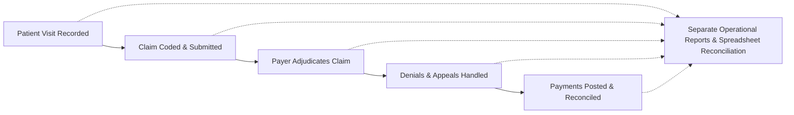
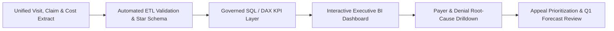

# AS-IS / TO-BE Process Mapping & Gap Analysis — Healthcare Revenue Cycle Intelligence

**Document ID:** HRCI-PROC-001

## 1. AS-IS Process Map (Fragmented Revenue Cycle Reporting)

**Key Pain Points:** Fragmented visibility across spreadsheets, delayed detection of payer denial surges, and inconsistent manual KPI formulas.

## 2. TO-BE Process Map (Integrated Executive Revenue Cycle Intelligence)

## 3. Gap Analysis & Success Measures
| Improvement Area | AS-IS Gap | TO-BE Capability | Validation Measure |
| :--- | :--- | :--- | :--- |
| **Reporting Visibility** | Disconnected visit, claim, and payment spreadsheets | Centralized star-schema executive dashboard | 100% KPI reconciliation against SQLite warehouse |
| **Denial Monitoring** | Limited cross-payer benchmarking | Ranked payer denial rates & 6 denial reason categories | Payer denial rate parity & filter responsiveness |
| **Collection Oversight** | Billed amounts vs. receipts reviewed manually | Monthly Billed vs. Paid & Billing Gap views | Exact monthly `Billed - Paid = Gap` reconciliation |
| **Appeals Management** | Appeal outcomes difficult to quantify monthly | Monthly Appealed vs. Overturned tracking | `Overturned <= Appealed <= Denied` invariant |
| **Decision Support** | Reactive historical reporting only | Dynamic filters + Q1 2026 forecast (95% CI) | Documented regression assumptions & CI bounds |
