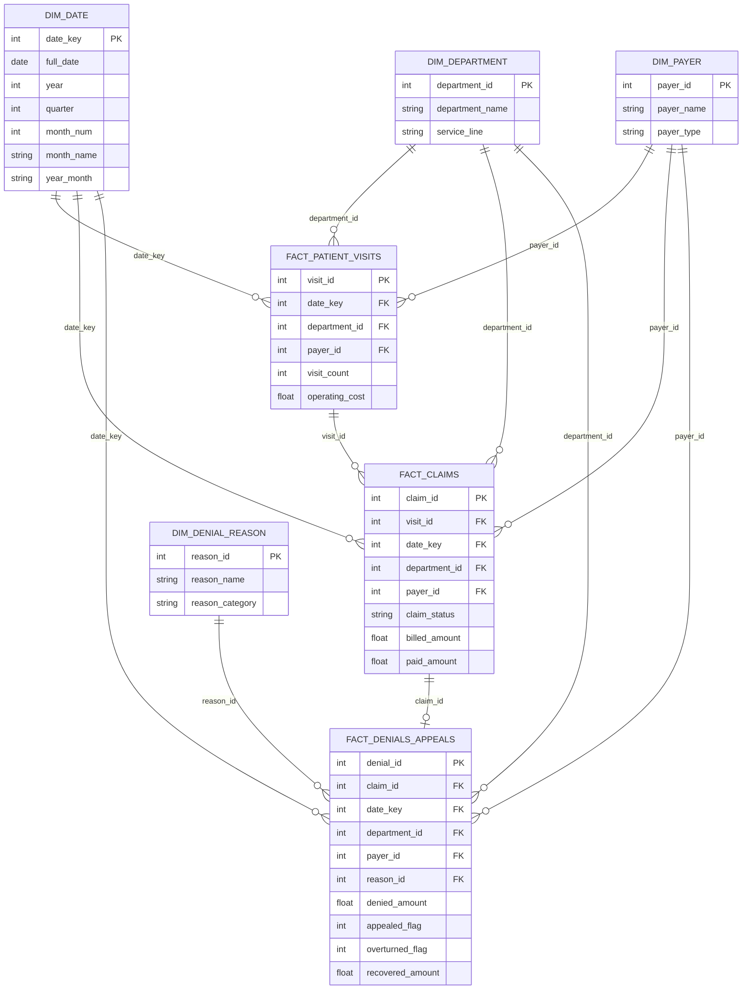

# Power BI Star Schema Data Model — Healthcare Revenue Cycle Intelligence

## Architecture Overview

The analytical model uses a 4-dimension, 3-fact star/constellation schema built from `data/processed/*.csv` or `data/processed/healthcare_rcm.db` (`SQLite` ODBC/Python connector).

## Relationships & Cardinality

| From Table (Many) | To Table (One) | Join Key | Cardinality | Cross-Filter Direction |
| :--- | :--- | :--- | :--- | :--- |
| `fact_patient_visits` | `dim_date` | `date_key` | Many-to-One (`*:1`) | Single |
| `fact_patient_visits` | `dim_department` | `department_id` | Many-to-One (`*:1`) | Single |
| `fact_patient_visits` | `dim_payer` | `payer_id` | Many-to-One (`*:1`) | Single |
| `fact_claims` | `dim_date` | `date_key` | Many-to-One (`*:1`) | Single |
| `fact_claims` | `dim_department` | `department_id` | Many-to-One (`*:1`) | Single |
| `fact_claims` | `dim_payer` | `payer_id` | Many-to-One (`*:1`) | Single |
| `fact_denials_appeals` | `dim_date` | `date_key` | Many-to-One (`*:1`) | Single |
| `fact_denials_appeals` | `dim_department` | `department_id` | Many-to-One (`*:1`) | Single |
| `fact_denials_appeals` | `dim_payer` | `payer_id` | Many-to-One (`*:1`) | Single |
| `fact_denials_appeals` | `dim_denial_reason` | `reason_id` | Many-to-One (`*:1`) | Single |
